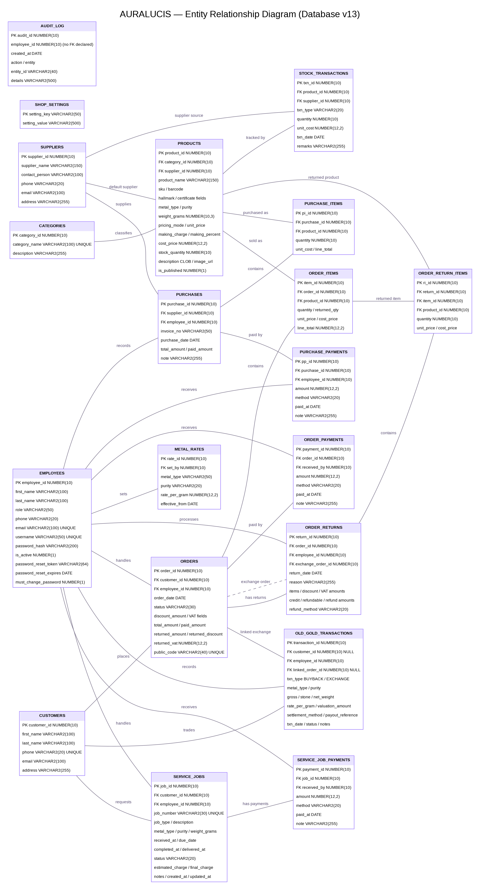
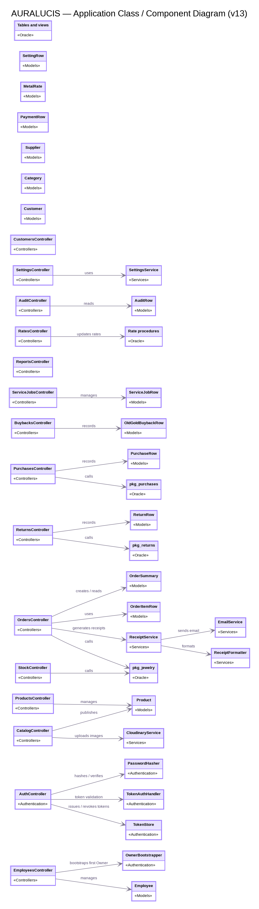

<p align="center">
  
</p>

<h1 align="center">AURALUCIS</h1>
<p align="center"><strong>Jewelry Shop &amp; Stock Management System</strong></p>
<p align="center"><em>Where Luxury Meets Precision.</em></p>

---

## Overview

AURALUCIS is a jewelry shop management application built around an Oracle database, an ASP.NET Core Web API, and a React frontend. It brings product cataloguing, inventory, sales, customer records, supplier purchases, returns, buybacks, repair/service jobs, reporting, and audit tracking into one system.

Core inventory and transaction rules are implemented in Oracle PL/SQL packages and database constraints, with the API providing authenticated application access and the frontend providing the shop interface.

## Features

- **Role-based accounts:** Owner, Manager, and Staff roles; first Owner account is provisioned through the backend bootstrap command. Manager and Owner permissions are enforced on protected management operations.
- **Products and catalog:** product categories, suppliers, SKU/barcode and hallmark/certificate details, metal and purity information, weight, pricing mode, cost, stock, descriptions, product images, and publication controls for the public catalogue.
- **Sales and orders:** multi-item sales, discounts, VAT, pending orders, partial payments, outstanding balances, and order completion/cancellation.
- **Receipts:** printable receipt data, PDF, email support, and a public receipt verification page using a random code.
- **Metal-rate pricing:** gold/silver rate history and products priced using weight, metal rate, and making-charge settings.
- **Inventory:** restocking, stock adjustments, stock transaction history, supplier-linked stock movements, and weighted-average product cost tracking.
- **Returns and exchanges:** item-level returns, refund/credit calculations, and exchange orders.
- **Supplier purchases:** purchase invoices, purchase items, supplier payments, and purchase balances.
- **Old-gold buybacks and exchanges:** records customer metal details, weights, valuation, settlement method, and optional linked exchange order.
- **Repair and service jobs:** customer job intake, job number, description, due date, status, charges, delivery tracking, and payments.
- **Public product catalogue:** public read-only product listing and detail endpoints for published products; Owner/Manager-controlled product publication and image upload.
- **Reports and audit:** dashboard and sales reporting, audit history, and shop settings.
- **Account recovery:** forgot-password and reset-password API flow, plus password change and employee password reset operations.

## Technology stack

| Layer | Technology |
|---|---|
| Database | Oracle Database 10g XE; SQL tables, sequences, triggers, views, constraints, and PL/SQL packages |
| Backend | ASP.NET Core Web API, C#, Dapper, Oracle Managed Data Access |
| Frontend | React 18, Vite, JavaScript |
| Product images | Cloudinary integration |
| Supporting libraries | QR code, html2canvas, jsPDF |

## Architecture and database diagrams

The diagrams below describe the current version 13 schema and the backend's main application components.

### Entity-Relationship Diagram



### Class / Component Diagram



## Project structure

```text
AURALUCIS/
├── database/             Oracle installation and upgrade SQL scripts
├── backend/
│   └── JewelryApi/       ASP.NET Core Web API
├── frontend/             React + Vite application
├── docs/                 Setup guides, diagrams, and project assets
└── scripts/              Utility and test scripts (where included)
```

## Database design

The version 13 database includes these main entities:

- **Core shop:** `categories`, `suppliers`, `products`, `customers`, `employees`
- **Sales and inventory:** `orders`, `order_items`, `order_payments`, `stock_transactions`
- **Shop configuration and tracking:** `shop_settings`, `audit_log`, `metal_rates`
- **Returns and purchasing:** `order_returns`, `order_return_items`, `purchases`, `purchase_items`, `purchase_payments`
- **Newer workflows:** `old_gold_transactions`, `service_jobs`, `service_job_payments`

Products also contain catalogue, image, SKU/barcode, hallmark, and certificate fields. Employee records include account, password-reset, activation, and password-change fields.

Important database packages include `pkg_jewelry`, `pkg_returns`, and `pkg_purchases`. The schema uses primary keys, foreign keys, unique constraints, check constraints, sequences, and triggers to protect data integrity.

## Getting started

> This project uses Oracle Database 10g XE. Use a dedicated development schema and back up any existing database before applying an upgrade.

### 1. Prepare the database

For a **fresh installation in an empty Oracle schema**, follow [docs/FRESH_INSTALL.md](docs/FRESH_INSTALL.md). The installer `database/install_all.sql` runs the installation scripts through version 13 and then runs the installation checks.

For an **existing AURALUCIS database**, do not run the full fresh installer. Back up the database and follow the applicable migration instructions. In particular, `database/upgrade_13.sql` is for an existing version 12 database and must only be run once.

### 2. Configure and run the backend

Open PowerShell in the project root:

```powershell
Copy-Item .\backend\JewelryApi\appsettings.example.json .\backend\JewelryApi\appsettings.json
```

Edit the local `backend/JewelryApi/appsettings.json` with your Oracle connection string. Configure email and Cloudinary settings only if those features are needed. The real local settings file is excluded from Git; never commit database passwords, API secrets, SMTP credentials, or tokens.

Then run:

```powershell
cd .\backend\JewelryApi
dotnet restore
dotnet run
```

The API listens locally at `http://localhost:5000`; Swagger is available at `http://localhost:5000/swagger`.

### 3. Create the first Owner account

With the backend stopped, run the bootstrap command from the repository root:

```powershell
dotnet run --project .\backend\JewelryApi -- --bootstrap-owner
```

Follow the interactive prompts to create the first Owner account. The bootstrap process refuses to create another Owner if one already exists. See [docs/OWNER_CATALOG_SETUP.md](docs/OWNER_CATALOG_SETUP.md) for details.

### 4. Run the frontend

Open a second PowerShell terminal:

```powershell
cd .\frontend
npm install
npm run dev
```

Open `http://localhost:5173` in your browser and sign in with the account you created.

## Configuration notes

- **Oracle:** set the local connection string in `appsettings.json`.
- **Email:** configure SMTP settings to enable password recovery and email receipts.
- **Cloudinary:** configure the Cloudinary cloud name, API key, and API secret for product image uploads. Keep credentials out of source control.
- **Public catalogue:** only products marked as published are exposed by the public catalogue endpoints.
- **Receipt verification:** public receipt verification uses the random receipt code; do not place customer or payment secrets in public links.

More details:
- [Fresh installation](docs/FRESH_INSTALL.md)
- [Owner, roles, public catalogue, Cloudinary, and password recovery](docs/OWNER_CATALOG_SETUP.md)
- [Email and QR setup](docs/EMAIL_QR_SETUP.md)
- [Backup and restore](docs/BACKUP_RESTORE.md)
- [User guide](docs/GUIDE.md)
- [Demo guide](docs/DEMO.md)

## API overview

The API is organized around the following controller routes. Authorization is applied by the controllers/actions; the table is a feature overview, not a replacement for endpoint-level permission checks.

| Area | Route base | Main operations |
|---|---|---|
| Authentication | `/api/auth` | Login, forgot/reset password, logout, current user, change password |
| Employees | `/api/employees` | Employee management, activation, password reset, username update |
| Products | `/api/products` | Product listing, details, create, update, delete |
| Categories / suppliers | `/api/categories`, `/api/suppliers` | Listing and management |
| Customers | `/api/customers` | Customer records and purchase history |
| Orders | `/api/orders` | Orders, items, receipt, sale, email, payments, complete, cancel |
| Returns | `/api/returns` | Return history, order return eligibility, returns and exchanges |
| Purchases | `/api/purchases` | Purchase listing/details, purchase creation, supplier payments |
| Stock | `/api/stock` | Restock, stock adjustment, transaction history |
| Rates | `/api/rates` | Current metal rates, rate history, rate updates |
| Buybacks | `/api/buybacks` | Old-gold buyback and exchange records |
| Service jobs | `/api/servicejobs` | Job intake, status, charge, and payment operations |
| Public catalogue | `/api/catalog` | Public catalogue listing/details; protected image upload |
| Public receipts | `/api/public/receipt` | Public receipt verification by code |
| Reports / audit | `/api/reports`, `/api/audit` | Dashboard, sales reports, audit history |
| Settings | `/api/settings` | Shop settings |

## Installation checks

Run `database/check_install.sql` in SQL*Plus after installation or migration. It checks required database objects and compilation status. Follow the installation guide for the expected successful result.

## Roadmap

The feature set is evolving. Confirmed implemented areas include the core sales and inventory workflows, returns, supplier purchases, metal-rate pricing, buybacks, service jobs, public catalogue, account recovery, and Owner account provisioning. Remaining work should be tracked against the current application and database source rather than assumed from an older checklist.

## Security and data

- Keep the GitHub repository private until you have reviewed all files for secrets and real business data.
- Never commit `appsettings.json`, `.env` files, database exports, backups, access tokens, SMTP passwords, or Cloudinary secrets.
- Use sample data only when sharing screenshots or demonstrations.
- A successful local build does not by itself mean the application has undergone a full production security or regression review.
